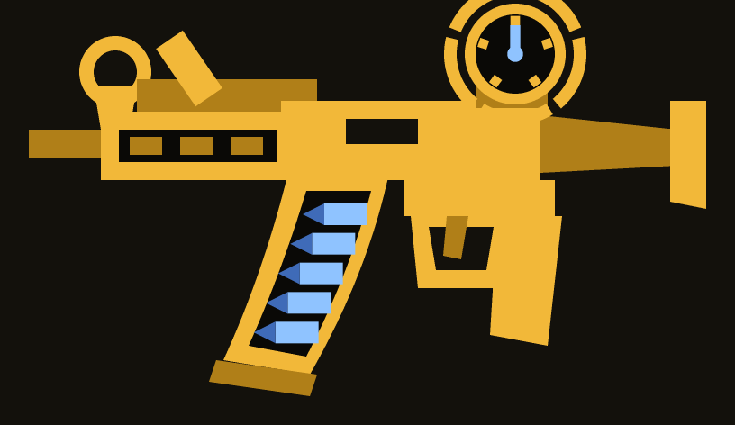

# MP5

<p align="center">
  
</p>

## Overview

MP5 zeigt die **tatsächliche** Mana-Regeneration pro 5 Sekunden – nicht aus
einer nachgebauten Formel, sondern aus den echten Mana-Ticks des Charakters.
Segen der Weisheit, Nahrung, Items und Volksfähigkeiten sind damit automatisch
enthalten. Steht dort 0, regeneriert gerade nichts.

- **Beide Stufen auf einen Blick** – `12 / 47`: innerhalb der 5-Sekunden-Regel
  und außerhalb. Die gerade gültige Zahl steht hell.
- **5-Sekunden-Regel als Balken** mit Restzeit darunter, sichtbar ab dem
  Moment des Zaubers.
- **Zauber-Leiste**: bis zu fünf eigene Zauber mit Icon und der Zahl, wie oft
  das Mana für diesen Zauber noch reicht – Zauberzeit und die Regeneration
  während des Zaubers eingerechnet.
- **Funktioniert auch auf Clients, die das aktuelle Mana nicht herausgeben** –
  dann wird es mitgerechnet: Kosten der gewirkten Zauber abziehen,
  Regeneration dazu. Die Zahlen sind dabei eine Untergrenze (`~5`) und werden
  exakt, sobald der Manatank einmal voll war.
- **Frei platzierbar und skalierbar**, Einstellungen pro Charakter.
- Reine Anzeige über offizielle Blizzard-Schnittstellen, keine Automatisierung.
  Der `OnUpdate` läuft nur während der 5 Sekunden nach einem Zauber.

Getestet auf WoW Classic (Interface 16001).

## Installation

1. Den Ordner `MP5/` nach `Interface/AddOns/` kopieren.
2. Den Spielclient neu starten (oder `/reload`).
3. MP5 im Charakterauswahl-Bildschirm unter *AddOns* aktivieren.

Der Pfad sieht je nach Installation so aus:

```
World of Warcraft/_classic_era_/Interface/AddOns/MP5/
```

Beim ersten Start erscheint die Anzeige in der Bildschirmmitte. Mit der Maus
verschieben, dann `/mp5 lock`.

## Configuration

Grafisch unter *Interface ▸ AddOns ▸ MP5* oder mit `/mp5 options`: die fünf
Zauberplätze (jedes Feld zeigt direkt die erkannten Kosten und die Zauberzeit),
Schieber für Breite, Icon-Größe, Gesamtgröße und Schrift sowie die Haken für
Balken, Restzeit, beide Stufen, Position und das Mitrechnen.

Alles geht auch per Chatbefehl:

| Befehl | Wirkung |
|---|---|
| `/mp5 lock` · `unlock` | Position fixieren / verschiebbar machen |
| `/mp5 scale <0.5-2>` | Gesamtgröße |
| `/mp5 font <8-32>` | Schriftgröße, unabhängig von der Gesamtgröße |
| `/mp5 width <80-400>` | Breite – Mindestbreite, die Zauber-Reihe darf breiter werden |
| `/mp5 bar off\|thin\|full` | kein Balken, dünner 5s-Strich oder Statusbar |
| `/mp5 bardir fill\|drain` | Balken füllt sich auf oder läuft leer |
| `/mp5 backdrop blizzard\|thin\|off` | Rahmen |
| `/mp5 full on\|off` | beide Stufen `12 / 47` |
| `/mp5 countdown on\|off` | Restzeit unter dem Balken |
| `/mp5 label on\|off` | Beschriftung „MANA / 5“ (Standard: aus) |
| `/mp5 tooltip on\|off` | Aufschlüsselung beim Drüberfahren |
| `/mp5 animate on\|off` | weiches Hochzählen (Standard: aus) |
| `/mp5 decimals 0\|1` | Nachkommastelle |
| `/mp5 show always\|combat\|notfull` | wann die Anzeige sichtbar ist |
| `/mp5 hide` · `unhide` | ganz aus- und einschalten |
| `/mp5 reset` | zurück auf die Standardwerte |

### Zauber-Leiste

```
/mp5 spells on                Leiste einschalten
/mp5 spell 1 Blitzheilung     höchster gelernter Rang
/mp5 spell 2 Erneuern(Rang 4) genau dieser Rang
/mp5 spell 3 clear            Platz leeren
/mp5 spell list               belegte Plätze zeigen
/mp5 icon <16-48>             Icon-Größe
/mp5 count topright|center    wo die Zahl auf dem Icon sitzt
/mp5 estimate on|off|reset    Mana mitrechnen, wenn der Client es schützt
/mp5 logo on|off              das Zeichen links in der Anzeige
```

### Diagnose

```
/mp5 probe     was der eigene Client an Mana-Daten hergibt
/mp5 why       warum gerade welche Zahl angezeigt wird
/mp5 errors    mitgeschriebene Fehler
```

## Logo

Das Hauptzeichen: im Magazin stecken fünf Manapatronen – eine je Sekunde der
Regel – und das Trommelvisier ist das Zifferblatt. Die Entwürfe liegen als
Handout in `docs/logo/index.html`, jedes Zeichen als SVG (dunkel und hell)
und als PNG daneben.

Im Spiel steckt es in `MP5/Textures/` als TGA – das einzige Bildformat neben
BLP, das WoW lädt. `logo.tga` (128×64) steht über den Interface-Optionen,
`icon.tga` (64×64, das Trommelvisier) ist das Symbol in der AddOn-Liste und
lässt sich mit `/mp5 logo on` links in die Anzeige holen.

## Tests

Die Messlogik läuft gegen einen API-Stub, ohne das Spiel zu starten:

```
lua5.1 tests/test_core.lua      # Messung der Mana-Ticks, 5-Sekunden-Regel
lua5.1 tests/test_spells.lua    # die Zauber-Rechnung, gegen eine Simulation
lua5.1 tests/test_apiregen.lua  # GetManaRegen als Quelle
lua5.1 tests/test_manabar.lua   # Mana aus dem Text der Standardleiste
lua5.1 tests/test_estimate.lua  # das Mana-Modell, gegen eine Simulation
lua5.1 tests/test_tainted.lua   # geschützte Werte im Kampf
lua5.1 tests/test_options.lua   # das Optionen-Panel
```

## Lizenz

MIT, siehe [LICENSE](LICENSE).
